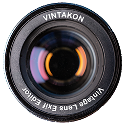

# Vintakon

Exiftool UI to edit vintage lens parameters.

Vintakon allows one to create profiles for lenses that don't provide exif information
and apply these profiles to multiple files at the same time.

Vintakon uses tested and proven [exiftool](https://exiftool.org/) for reading and writing exif information.

Vintakon name doesn't mean anything. It's just a play on word "vintage" and "-kon" suffix, which sounds like a 
vintage lens name. 
