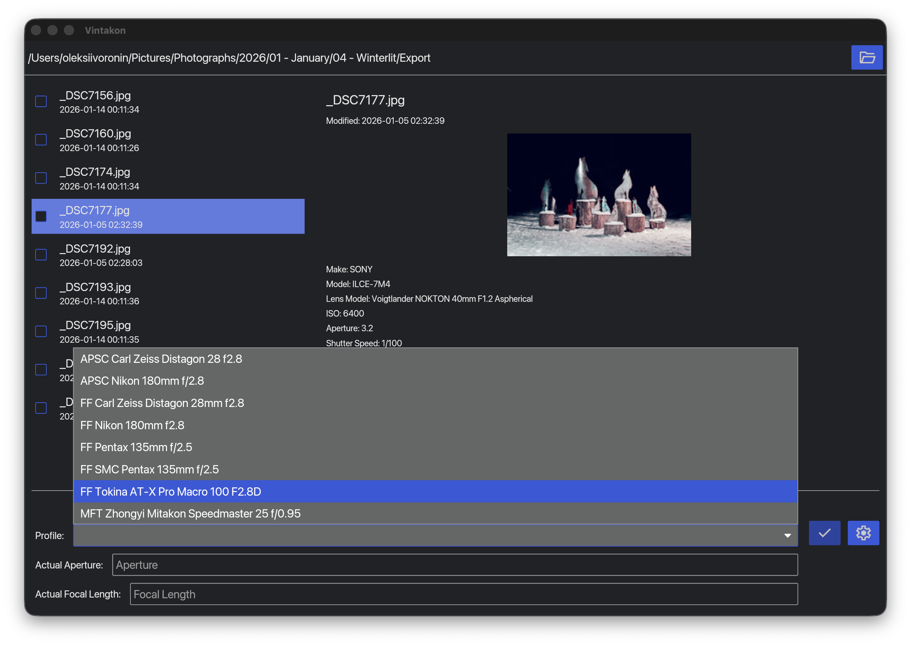

# Vintakon

Vintakon is an UI for Exiftool, specifically designed to modify exif information for manual lenses that don't have electronic contacts and don't provide any exif information. Vintakon allows user to create profiles for their lenses and apply these profiles to multiple files simultaneously.

Vintakon uses tested and proven [exiftool](https://exiftool.org/) for reading and writing exif information and supports most of the image file formats that are supported by exiftool.

Vintakon name doesn't mean anything. It's just a play on word "vintage" and "-kon" suffix, which sounds like a
vintage lens name.

## Using

`exiftool` must be installed. Use your package manager to install it on Linux. On MacOS you can install it using Homebrew.

On MacOS and Windows you need to set path to exiftool executable in settings. On linux it should work out of the box.

## Limitations

exiftool is unable to overwrite all tags. For example, `FocalLength` in Sony a7IV .ARW files
is not stored in standard EXIF tag 920A, but instead in maker notes. Exiftool doesn't allow to
alter maker notes to avoid potential conflicts with vendor software. This means that if you apply
lens profile with a Focal length to .ARW file, the focal length tag will not be updated.

# Notes

This project is a rewrite/translation of the previous version, written in Dart/Flutter. I was not happy with the binary built by Flutter and wanted to try Rust for UI development. This project was mostly vibe-coded in couple of days using Claude, so the code is neither good, nor idiomatic. I am not planning on rewriting it as it does what it is intended to do.

# License

Vintakon is licensed under the MIT license. See the LICENSE.txt file for more details.
